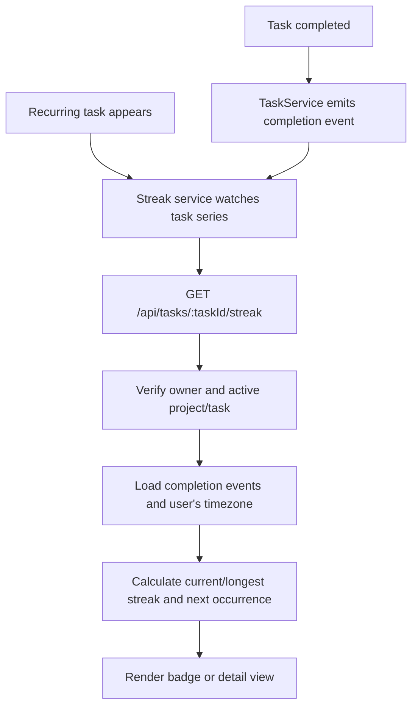

# 12. View a Task Streak

## In simple terms

Recurring tasks can show a streak badge and a detail view. HabitFlow counts completions in the person's timezone, tracks the longest and current streak, and determines the next occurrence. When a task is completed anywhere in the app, watched streaks refresh.

## Flowchart



## Data flow walkthrough

Each numbered item describes one file. Comments explain how a task completion becomes a refreshed streak.

### 1. `frontend/src/app/features/tasks/task-streaks/services/task-streaks.service.ts`

```ts
// Request streak details for a task; the service caches watched recurring tasks.
get(taskId: number): Observable<ApiTaskStreak> {
  return this.http.get<ApiTaskStreak>(`${this.baseUrl}/${taskId}/streak`);
}

// Completion events from TaskService refresh this task and other occurrences in its series.
inject(TaskService).completions.pipe(takeUntilDestroyed()).subscribe(({ taskId }) =>
  this.refreshSeries(taskId),
);
```

### 2. `frontend/src/app/features/tasks/task-streaks/components/streak-badge/streak-badge.ts`

```ts
constructor() {
  effect(() => {
    const task = this.task();
    // Load only when this badge receives a task and no preloaded streak was supplied.
    if (task && !this.known()) this.streaks.watch(task);
  });
}
```

### 3. `backend/src/features/tasks/task-streaks/task-streaks.routes.ts`

```ts
router.use(requireAuth(sessionService));
router.get(
  '/:taskId/streak',
  validateRequest(
    taskIdParamValidator,
    'params',
    'Task ID must be a positive integer'
  ),
  async (req, res, next) => {
    try {
      // Use the verified owner ID and return 404 for another user's/missing task.
      const result = await service.getTaskStreak(
        Number(req.params.taskId),
        req.auth!.userId
      );
      if (!result)
        return res
          .status(404)
          .json({ error: 'Task not found', code: 'task-not-found' });
      res.status(200).json(result);
    } catch (error) {
      next(error);
    }
  }
);
```

### 4. `backend/src/features/tasks/task-streaks/task-streaks.service.ts`

```ts
// Find a live, unarchived task for this owner and load its completion events.
const task = await prisma.task.findFirst({
  where: { id: taskId, userId, deletedAt: null, archivedAt: null },
  include: { completionEvents: true },
});
if (!task) return null;
// Read the account timezone because streak boundaries use the user's local day.
const owner = await prisma.user.findUnique({
  where: { id: userId },
  select: { timezone: true },
});
// Use the owner's timezone to define today and recurrence boundaries.
const timezone = owner?.timezone ?? 'UTC';
const today = localDateString(timezone);
```

See [tests.md](tests.md) for badge, streak calculation, and API coverage.
