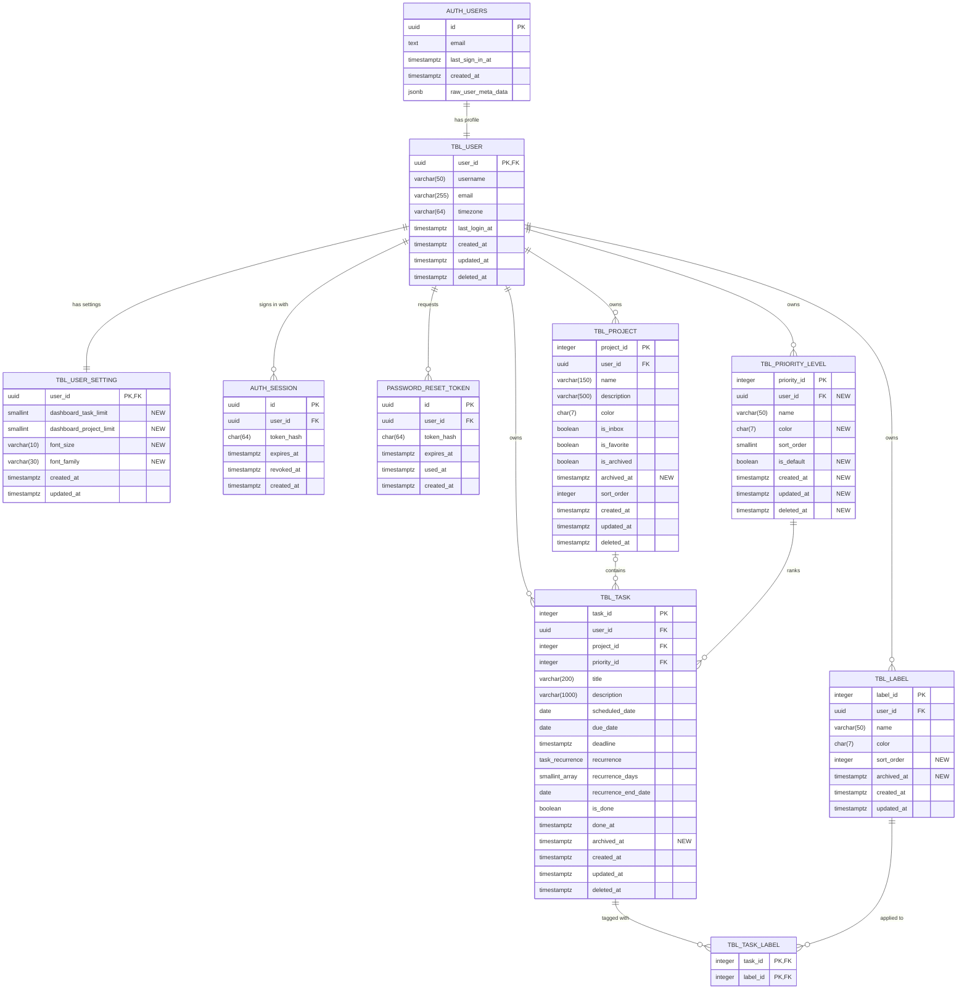

# Database Schema

Last Updated: November 7, 2026 | Version 1.3.0

[Lucidchart document](https://lucid.app/lucidchart/f9bc6885-894c-41a6-a764-e8d6f279449a/view)

## auth.users (Supabase managed)

| Key | Column             | Type        |
| --- | ------------------ | ----------- |
| PK  | id                 | uuid        |
|     | email              | text        |
|     | last_sign_in_at    | timestamptz |
|     | created_at         | timestamptz |
|     | raw_user_meta_data | jsonb       |

## tbl_user (profile)

| Key   | Column        | Type         |
| ----- | ------------- | ------------ |
| PK,FK | user_id       | uuid         |
|       | username      | varchar(50)  |
|       | email         | varchar(255) |
|       | timezone      | varchar(64)  |
|       | last_login_at | timestamptz  |
|       | created_at    | timestamptz  |
|       | updated_at    | timestamptz  |
|       | deleted_at    | timestamptz  |

## tbl_user_setting (new)

| Key   | Column                      | Type            |
| ----- | --------------------------- | --------------- |
| PK,FK | **user_id**                 | **uuid**        |
|       | **dashboard_task_limit**    | **smallint**    |
|       | **dashboard_project_limit** | **smallint**    |
|       | **font_size**               | **varchar(10)** |
|       | **font_family**             | **varchar(30)** |
|       | **created_at**              | **timestamptz** |
|       | **updated_at**              | **timestamptz** |

## auth_session

| Key | Column     | Type        |
| --- | ---------- | ----------- |
| PK  | id         | uuid        |
| FK  | user_id    | uuid        |
|     | token_hash | char(64)    |
|     | expires_at | timestamptz |
|     | revoked_at | timestamptz |
|     | created_at | timestamptz |

## password_reset_token

| Key | Column     | Type        |
| --- | ---------- | ----------- |
| PK  | id         | uuid        |
| FK  | user_id    | uuid        |
|     | token_hash | char(64)    |
|     | expires_at | timestamptz |
|     | used_at    | timestamptz |
|     | created_at | timestamptz |

## tbl_priority_level

| Key | Column         | Type            |
| --- | -------------- | --------------- |
| PK  | priority_id    | **integer**     |
| FK  | **user_id**    | **uuid**        |
|     | name           | varchar(50)     |
|     | **color**      | **char(7)**     |
|     | sort_order     | smallint        |
|     | **is_default** | **boolean**     |
|     | **created_at** | **timestamptz** |
|     | **updated_at** | **timestamptz** |
|     | **deleted_at** | **timestamptz** |

## tbl_project

| Key | Column          | Type            |
| --- | --------------- | --------------- |
| PK  | project_id      | integer         |
| FK  | user_id         | uuid            |
|     | name            | varchar(150)    |
|     | description     | varchar(500)    |
|     | color           | char(7)         |
|     | is_inbox        | boolean         |
|     | is_favorite     | boolean         |
|     | is_archived     | boolean         |
|     | **archived_at** | **timestamptz** |
|     | sort_order      | integer         |
|     | created_at      | timestamptz     |
|     | updated_at      | timestamptz     |
|     | deleted_at      | timestamptz     |

## tbl_task

| Key | Column              | Type            |
| --- | ------------------- | --------------- |
| PK  | task_id             | integer         |
| FK  | user_id             | uuid            |
| FK  | project_id          | integer         |
| FK  | priority_id         | **integer**     |
|     | title               | varchar(200)    |
|     | description         | varchar(1000)   |
|     | scheduled_date      | date            |
|     | due_date            | date            |
|     | deadline            | timestamptz     |
|     | recurrence          | task_recurrence |
|     | recurrence_days     | smallint[]      |
|     | recurrence_end_date | date            |
|     | is_done             | boolean         |
|     | done_at             | timestamptz     |
|     | **archived_at**     | **timestamptz** |
|     | created_at          | timestamptz     |
|     | updated_at          | timestamptz     |
|     | deleted_at          | timestamptz     |

## tbl_label

| Key | Column          | Type            |
| --- | --------------- | --------------- |
| PK  | label_id        | integer         |
| FK  | user_id         | uuid            |
|     | name            | varchar(50)     |
|     | color           | char(7)         |
|     | **sort_order**  | **integer**     |
|     | **archived_at** | **timestamptz** |
|     | created_at      | timestamptz     |
|     | updated_at      | timestamptz     |

## tbl_task_label

| Key   | Column   | Type    |
| ----- | -------- | ------- |
| PK,FK | task_id  | integer |
| PK,FK | label_id | integer |

## Relationships

| From                           | To                           | Cardinality         | On delete                                                            |
| ------------------------------ | ---------------------------- | ------------------- | -------------------------------------------------------------------- |
| auth.users.id                  | tbl_user.user_id             | one to one          | cascade                                                              |
| tbl_user.user_id               | tbl_user_setting.user_id     | one to one          | cascade                                                              |
| tbl_user.user_id               | auth_session.user_id         | one to many         | cascade                                                              |
| tbl_user.user_id               | password_reset_token.user_id | one to many         | cascade                                                              |
| tbl_user.user_id               | tbl_project.user_id          | one to many         | cascade                                                              |
| tbl_user.user_id               | tbl_task.user_id             | one to many         | cascade                                                              |
| tbl_user.user_id               | tbl_label.user_id            | one to many         | cascade                                                              |
| tbl_user.user_id               | tbl_priority_level.user_id   | one to many         | cascade                                                              |
| tbl_project.project_id         | tbl_task.project_id          | zero or one to many | set null                                                             |
| tbl_priority_level.priority_id | tbl_task.priority_id         | one to many         | restrict (tasks are moved with reassignTo before a level is deleted) |
| tbl_task.task_id               | tbl_task_label.task_id       | one to many         | cascade                                                              |
| tbl_label.label_id             | tbl_task_label.label_id      | one to many         | cascade                                                              |

## Rules (Sprint 5)

**Archive**

- `archived_at` is null for an active row and holds the time it was archived otherwise. Tasks, projects and labels can be archived.
- `tbl_project.is_archived` is kept for the Sprint 2 API. Check `tbl_project_archived_at_check` keeps it equal to `archived_at is not null`, and check `tbl_project_inbox_not_archived` stops the Inbox from being archived.
- Archived is not deleted: `deleted_at` still marks a soft delete, and an archived row is restored by clearing `archived_at`.

**Priorities and labels**

- Priority levels belong to one user. Every user starts with their own Low, Medium and High (Medium is the default) from `create_default_priorities(user_id)`, which runs at sign-up.
- Each user has exactly one `is_default` level (partial unique index), unique level names ignoring case among non-deleted rows, and unique `sort_order` values (deferrable, so levels can be reordered in one transaction).
- A task may only point at a priority level owned by the same user. Deleting a level is a soft delete after its tasks are moved to another level.
- `tbl_label.sort_order` sets the order of labels in Settings, pickers and filters.

**Settings**

- One `tbl_user_setting` row per user, created at sign-up and backfilled for existing users.
- `dashboard_task_limit` and `dashboard_project_limit`: 1–50, default 5.
- `font_size`: small, medium (default), large or x-large.
- `font_family`: system (default), sans-serif, serif, monospace or atkinson-hyperlegible.

## Indexes added in Sprint 5

| Table                 | Index                                                                                        | Purpose                |
| --------------------- | -------------------------------------------------------------------------------------------- | ---------------------- |
| tbl_task              | (user_id, project_id, priority_id) where deleted_at is null                                  | Sorting & Filtering    |
| tbl_task              | (user_id, due_date) where deleted_at is null                                                 | Sorting & Filtering    |
| tbl_task_label        | (label_id, task_id)                                                                          | Sorting & Filtering    |
| tbl_project           | (user_id, is_favorite, is_archived)                                                          | Sorting & Filtering    |
| tbl_task              | (user_id, archived_at desc) where deleted_at is null and archived_at is not null             | Archive page           |
| tbl_task              | (user_id, project_id) where deleted_at is null and archived_at is null                       | Active-only task lists |
| tbl_label             | (user_id, archived_at desc) where archived_at is not null                                    | Archive page           |
| tbl_project           | (user_id, archived_at desc) where deleted_at is null and archived_at is not null             | Archive page           |
| tbl_priority_level    | unique (user_id, lower(name)) where deleted_at is null                                       | Labels & Priorities    |
| tbl_priority_level    | unique (user_id) where is_default and deleted_at is null                                     | Labels & Priorities    |
| tbl_label             | (user_id, sort_order)                                                                        | Labels & Priorities    |
| tbl_task, tbl_project | GIN trigram (gin_trgm_ops) on title, description, name, description where deleted_at is null | Search                 |

## Changes from Version 1.1.0

- Added `tbl_user_setting` (Sprint 5 Settings: dashboard load limits, font size and font family).
- `tbl_priority_level` is now per user: added `user_id`, `color`, `is_default`, `created_at`, `updated_at` and `deleted_at`; `priority_id` (and `tbl_task.priority_id`) changed from smallint to integer; the global name check and global unique constraints were replaced by per-user ones (Sprint 5 Labels & Priorities).
- Added `sort_order` to `tbl_label` (Sprint 5 Labels & Priorities).
- Added `archived_at` to `tbl_task`, `tbl_label` and `tbl_project` (Sprint 5 Archive).
- Added the Sprint 5 filter, archive, priority and search indexes listed above.
- No task notes table: the Task Notes deliverable was removed because tasks already have a description field.
- Brought the diagram in line with the applied migrations: `tbl_task` now has `user_id`, `scheduled_date`, `recurrence`, `recurrence_days`, `recurrence_end_date`, `is_done` and `done_at`, `deadline` is `timestamptz` and `description` is `varchar(1000)`; recurrence is stored on the task, so `tbl_recurrence_rule`, `due_time`, `completed_at` and the task `sort_order` from 1.1.0 are not in the database. `tbl_user` gains `email` and `last_login_at`, and `auth_session` and `password_reset_token` are shown.
