# Work Breakdown Structure Diagram

Updated November 7, 2026 from the [WBS document](WBS_Document.md), version 2.2.0. This overview follows the original diagram's feature-level scope; see the source document for database, API, integration-test, and regression-test deliverables.

```mermaid
%%{init: {"flowchart": {"useMaxWidth": false}}}%%
flowchart TB
    root(["0. Task & Project Mgmt. App"])

    root --> p1["1. Project Documentation"]
    root --> p2["2. UI/UX Design"]
    root --> p3["3. User Authentication"]
    root --> p4["4. Project Mgmt. Feature"]
    root --> p5["5. Task Mgmt. Feature"]
    root --> p6["6. Dashboard & Reporting"]
    root --> p7["7. Optional Enhancements"]
    root --> p8["8. Backend Infrastructure"]
    root --> p9["9. QA, Deployment & Presentation"]

    p1 --> p1a["Planning Docs"]
    p1 --> p1b["Requirements Docs"]
    p1a --> p1a1["Project Proposal"]
    p1a --> p1a2["WBS & Timeline"]
    p1b --> p1b1["User Story Document"]
    p1b --> p1b2["Use Case Diagram"]

    p2 --> p2a["Wireframes & Mockups"]
    p2 --> p2b["Design System"]
    p2a --> p2a1["Low-Fidelity Wireframes"]
    p2a --> p2a2["High-Fidelity Mockups"]
    p2b --> p2b1["Style Guide"]
    p2b --> p2b2["Responsive Layout Specs"]

    p3 --> p3a["Registration"]
    p3 --> p3b["Login & Session"]
    p3 --> p3c["Password Recovery"]
    p3 --> p3d["Profile Management"]
    p3a --> p3a1["Sign-Up UI"]
    p3a --> p3a2["Account Creation API"]
    p3b --> p3b1["Login UI"]
    p3b --> p3b2["Auth API & Session Handling"]
    p3c --> p3c1["Forgot/Reset Password UI"]
    p3c --> p3c2["Forgot/Reset Password API"]
    p3d --> p3d1["Profile Settings UI"]
    p3d --> p3d2["Update Profile API"]

    p4 --> p4a["Project CRUD"]
    p4 --> p4b["Project Organization"]
    p4a --> p4a1["Create/Edit Project UI"]
    p4a --> p4a2["Project API Endpoints"]
    p4b --> p4b1["Project List/Switcher UI"]
    p4b --> p4b2["Favorites, Archive & Ordering"]

    p5 --> p5a["Task CRUD"]
    p5 --> p5b["Task Scheduling"]
    p5 --> p5c["Task Organization"]
    p5a --> p5a1["Create/Edit/Delete Task UI"]
    p5a --> p5a2["Task API Endpoints"]
    p5b --> p5b1["Due Date & Deadline"]
    p5b --> p5b2["Recurring Tasks"]
    p5c --> p5c1["Priority Levels"]
    p5c --> p5c2["Labels/Tags"]

    p6 --> p6a["Current & Upcoming Tasks View"]
    p6 --> p6b["Overdue Tasks View"]

    p7 --> p7a["Sorting & Filtering"]
    p7 --> p7b["Archive"]
    p7 --> p7c["Labels & Priorities Management"]
    p7 --> p7d["Settings: Config & Preferences"]
    p7 --> p7e["Search"]
    p7a --> p7a1["Filter Bar & Sort Menu"]
    p7a --> p7a2["URL-Persisted Filters"]
    p7b --> p7b1["Archive Actions & Page"]
    p7b --> p7b2["Read-Only Archived Tasks"]
    p7c --> p7c1["Settings: Labels & Priorities UI"]
    p7c --> p7c2["Custom Priorities & Ordered Labels"]
    p7d --> p7d1["Dashboard & Project List Limits"]
    p7d --> p7d2["Font Size & Family Preferences"]
    p7d --> p7d3["Limited Dashboard Widgets"]
    p7e --> p7e1["Global Search API"]
    p7e --> p7e2["Search Box & Results UI"]

    p8 --> p8a["Database"]
    p8 --> p8b["API Layer"]
    p8a --> p8a1["Database Schema Design"]
    p8a --> p8a2["Database Deployment"]
    p8b --> p8b1["API Specification"]
    p8b --> p8b2["API Testing"]

    p9 --> p9a["Deployment"]
    p9 --> p9b["Presentation"]
    p9a --> p9a1["Hosted Web Application"]
    p9a --> p9a2["GitHub Repo & README"]
    p9b --> p9b1["Presentation Slide Deck"]
    p9b --> p9b2["Live Project Demo"]

    classDef default fill:#F3F5F7,color:#17212B,stroke:#596579,stroke-width:1px
    classDef root fill:#202938,color:#FFFFFF,stroke:#111827,stroke-width:2px
    classDef docs fill:#1F4E79,color:#FFFFFF,stroke:#163A5B
    classDef design fill:#0F6B70,color:#FFFFFF,stroke:#0A4D51
    classDef auth fill:#22623A,color:#FFFFFF,stroke:#18492A
    classDef projects fill:#9B2C2C,color:#FFFFFF,stroke:#762020
    classDef tasks fill:#9A4D00,color:#FFFFFF,stroke:#753A00
    classDef dashboard fill:#563C88,color:#FFFFFF,stroke:#3E2A65
    classDef enhancements fill:#176B62,color:#FFFFFF,stroke:#105047
    classDef infrastructure fill:#425466,color:#FFFFFF,stroke:#2E3A48
    classDef delivery fill:#8A2E54,color:#FFFFFF,stroke:#68213E

    class root root
    class p1 docs
    class p2 design
    class p3 auth
    class p4 projects
    class p5 tasks
    class p6 dashboard
    class p7 enhancements
    class p8 infrastructure
    class p9 delivery
```

