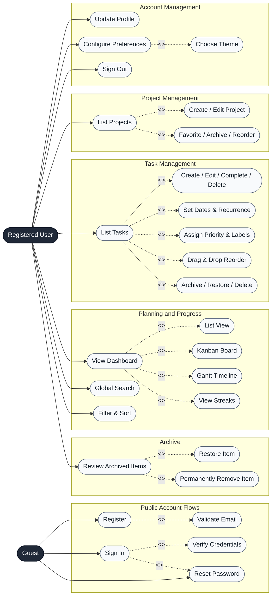

# HabitFlow Use-Case Diagram

**Version:** 1.0.0  
**Created:** 2026-09-24  
**Last Updated:** 2026-11-25

This diagram separates public account flows from authenticated task-management flows. All registered-user cases operate on data owned by that user.

